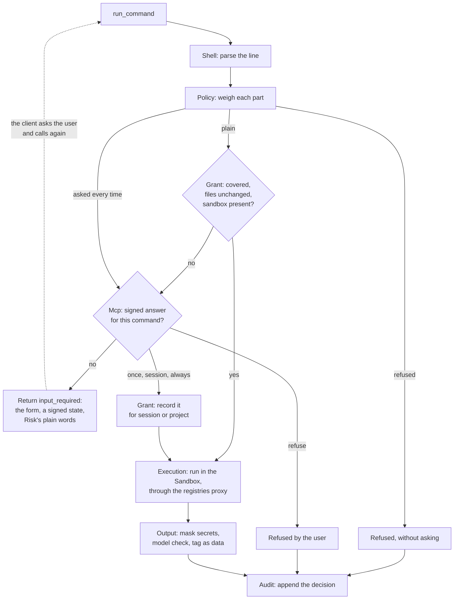

# Airlock: architecture

How the code is laid out, and the path one command takes through it. Why it works this way:
[design.md](design.md) and [decisions.md](decisions.md).

Airlock is one Symfony 8.1 application, run two ways from the same binary: as an MCP server over stdio (what a client
starts), and as a set of terminal commands (`airlock configure`, `connect`, `doctor`, `grants`, `log`). Everything
lives under `src/`, one namespace per module, with no layers inside them: a module is what it does.

## The modules

| Module | Its role |
|---|---|
| `Mcp` | What a client sees: the tools (`run_command`, `github_pr_checks`, `github_pr_comments`, `github_open_pr`), the `airlock://audit` resource, the approval form, and the signed state that carries the answer back. Discovered by the MCP bundle from this namespace. |
| `Shell` | Reads a command line the way bash does (`Lexer`, `ShellParser`), into the simple commands it runs, or says why it cannot be read whole (`Opacity`). |
| `Policy` | Weighs each part of a line: plain, asked every time (`Danger`), or refused by the policy files (`PolicyFiles`). The worst part decides (`Assessment`). |
| `Grant` | What the user allowed: for this session (`SessionGrants`, in memory) or for the project (`ProjectGrants`, on disk), each bound to the hashes of the files deciding what its command does (`CommandSources`). |
| `Sandbox` | Finds the sandbox this machine can run (`SandboxDetector`) and builds the confined command line: `Bubblewrap` on Linux, `SandboxExec` on macOS, `NoSandbox` saying why there is none. |
| `Execution` | Runs the line with bash inside the sandbox, from the project, within a timeout (`CommandRunner`), with a registries proxy started for it when the network is limited to the registries (`RegistriesProxy`). |
| `Network` | The registries-only proxy itself (`airlock network-proxy`): which hosts a command may reach (`NetworkFiles`, `ProxyGate`) and the relay. See [network.md](network.md). |
| `Output` | What comes back: secrets masked (`SecretMasker`), the output tagged as data (`DataTag`), read in chunks by a model for injection (`ModelInjectionClassifier`). |
| `Risk` | One line, from a model, saying what a command asked every time would do (`ModelRiskExplainer`). |
| `Audit` | Every decision appended as one JSON line, under a lock, rotated past a size (`AuditLog`). |
| `GitHub` | Reads a pull request's checks and comments, and opens one, with the user's own `gh`, outside the sandbox. |
| `Configuration` | Airlock's own directory, out of every command's reach (`ConfigDirectory`), and the model settings `airlock configure` calibrates and writes. |
| `Connect` | `airlock connect`: edits each client's configuration files (Claude Code, Codex, Cursor, Goose, VS Code) in place, keeping what else they hold, and puts them back with `--remove`. |
| `Doctor` | `airlock doctor`: one `Check` per concern (sandbox, policy, grants, private files, clients, model checks). |
| `Command`, `Console` | The terminal commands and the application that runs them. |

The files those modules read and write: [formats.md](formats.md).

## One `run_command` call

`RunCommandTool::__invoke()` (`src/Mcp/RunCommandTool.php`) drives it all.

In order:

1. `ShellParser::parse()` gives a `CommandLine`: its simple commands, or an `Opacity` when it cannot be read whole.
2. `CommandPolicy::assess()` weighs it against the refusals `PolicyFiles` reads on every call. A broken policy file
   stops everything: the call fails and nothing runs.
3. A plain line runs without asking only when `Grants::covers()` says every part is granted, none of the files behind
   them has changed, nothing on the line can change them first, and a sandbox is there. Otherwise `Grants::miss()`
   says why, for the form.
4. Without an answer, `Approvals::ask()` returns an `InputRequiredResult`: the `ApprovalForm`, and a state minted by
   the MCP bundle with the command's fingerprint and a one-use token. On the retry, `Approvals::answer()` takes the
   answer only if the state matches this command and the token was never used.
5. *Session* or *always* adds the grants `GrantRules::for()` derives from the line. `CommandRunner` runs it in the
   sandbox; only a command the user has just allowed gets the SSH agent, never one a grant covers.
6. The output is masked, checked by the `InjectionClassifier` (or marked as not checked, saying why), and returned by
   `OutputReport` between tags the output cannot close.
7. Every ending, run, refused or failed, is one `AuditEntry` in the `AuditLog`.

The GitHub tools take the same last two steps: what they read is checked, tagged as data and audited.
`github_open_pr` goes through the same form, offering only *once* or *refuse*.

## Wiring

Autowiring and attributes only: the tools are found by the MCP bundle in `App\Mcp`, the checks and the client
connectors are tagged by their interface (`Doctor\Check`, `Connect\ClientConnector`). Where there is a choice of
implementation, the interface stays small (`Sandbox`, `InjectionClassifier`, `RiskExplainer`) and tests replace it.
`config/packages/mcp.yaml` sets stdio only, in-memory sessions and the state's signing key;
`ai_generic_platform.yaml` points the platform at the API set in `models.yaml` or the environment.

## Tests

`tests/` mirrors `src/`, one directory per module. `composer check` runs the formatter, Rector, PHPStan and PHPUnit;
CI runs it, then one command through the server and one through the Docker image.

- `tests/Shell`: the parser by its public API, and `ShellParserFuzzTest`, random lines with fixed seeds run in bash to
  check every command bash runs is one the parser read.
- `tests/Policy`, `tests/Grant`: the policy and grants by their rules, and `GrantPropertiesTest`, random lines checked
  for properties (no grant covers an ungranted part, no part makes a line milder).
- `tests/Injection`: a public corpus of injected commands.
- `tests/Mcp`: the server started as a process and spoken to over stdio (`StdioClient`), in both protocol eras.
- `tests/Output`, `tests/Risk`: the model calls against recorded responses in `tests/Fixtures/models`: no test reaches
  the network.
- `tests/Sandbox`, `tests/Network`, `tests/Connect`, `tests/Doctor`, …: each module by its public API, with in-memory
  fakes (`FixedResolver`, `LocalDialer`, `InMemoryGitAliases`) where it would touch the machine.
